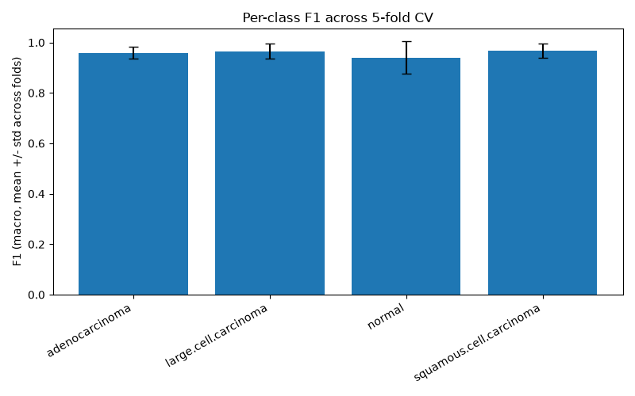
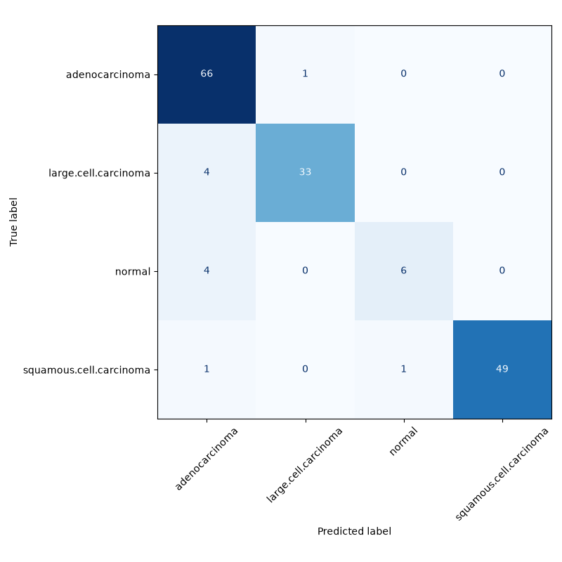

# EfficientNet Lung CT Cancer Subtyping

> **This is a machine learning research project, not a medical device.** It is not intended for clinical use, diagnosis, or any healthcare decision-making, and has not been validated for that purpose. Predictions must never be used to make or support real medical decisions without review by a qualified pathologist/radiologist.

Fine-tuned **EfficientNet-B0** model that classifies lung CT-scan images into four categories: `adenocarcinoma`, `large.cell.carcinoma`, `normal`, `squamous.cell.carcinoma`.

## Setup

```bash
git clone <repository-url>
cd efficientnet-lung-ct-cancer-subtyping
./run_training.sh
```

This single script creates a local `.venv`, installs `requirements.txt`, checks for a CUDA-capable GPU, downloads the raw dataset from Hugging Face if `data/raw/Data` is missing, then runs the full pipeline: `model-info` -> `audit-data` -> `make-splits` -> `cv` -> `final-train` -> `evaluate`. Every step is idempotent (skipped if its output already exists), so re-running the script after an interruption picks up where it left off.

If you need a specific CUDA toolkit build of `torch`/`torchvision` (rather than whatever PyPI resolves by default), install those two packages manually per [pytorch.org/get-started](https://pytorch.org/get-started/locally/) before running the script.

## Dataset

**Source.** Four-class lung CT-scan classification dataset (`adenocarcinoma`, `large.cell.carcinoma`, `normal`, `squamous.cell.carcinoma`), originally published by Kabil007 on Hugging Face (`Kabil007/LungCancer4Types`, Apache-2.0 license) and mirrored at `yunussgultekiin/lung-cancer-dataset`. The raw archive ships 1000 images split into `train` (613) / `valid` (72) / `test` (315) folders.

**Audit.** Before trusting that split, `src/data_audit.py` hashes every file (MD5 exact match + perceptual hash via `imagehash.phash`) and clusters duplicates within each class. This found:

- **`normal`-class duplication.** Only 49 of the 215 `normal` files are actually distinct images (4.39x duplication, via copy-pasted files like `11.png` / `11 - Copy.png` / `11 - Copy (2).png`). The other three classes are barely affected (~1.01-1.02x).
- **Cross-split leakage.** 85% of the `normal` images in the original `test` folder are exact-or-near-duplicate copies of images already in `train`/`valid` — the original split is not a clean, leakage-free holdout for that class.
- **One cross-label duplicate.** A single image is filed under two different, mutually exclusive labels (`large.cell.carcinoma` and `squamous.cell.carcinoma`) — byte-identical, almost certainly a labeling mistake in the source dataset. Since there is no way to tell which label is correct, both copies are excluded entirely (`data/splits/cross_label_hash_collisions.csv`).
- **Image-level, not patient-level, grouping.** No patient/study identifiers exist anywhere in the dataset (filenames are generic; class-folder names encode TNM stage shared by the whole class, not per patient). Cross-validation is therefore grouped by verified duplicate-cluster id as the best available proxy — this prevents the specific leakage pattern above, but cannot rule out leakage between visually distinct images from the same patient/study, which is not resolvable without metadata this dataset doesn't provide.
- **HF dataset-card row count.** The dataset card's viewer reports "1,001 rows" while the documented split sums to 1000; this project's own audit found exactly 1000 image files with 0 corrupted/unreadable files, so the "1,001" figure is almost certainly a benign viewer artifact, not a real data issue.

A visual walkthrough of these findings (duplicate images shown side by side, the cross-label pair, etc.) is in [`exploratory_data_analysis.ipynb`](exploratory_data_analysis.ipynb).

**Resulting splits.** The pipeline deduplicates the raw data down to 824 unique images and draws one fixed held-out test set (165 images) plus a 5-fold cross-validation split from the remaining 659-image dev pool, both grouped by duplicate-cluster id so no duplicate image can cross a split boundary (`src/splits.py`). Because the `normal` class is so small, expect roughly 10 `normal` images in the held-out test set and 7-8 per CV fold — per-class metrics for `normal` should be read with that variance in mind.

## Model

- **Architecture:** `torchvision.models.efficientnet_b0`, pretrained on ImageNet, with the classifier head rebuilt as `Dropout -> Linear(num_classes)` (`src/model.py`).
- **Input size:** 224x224 RGB, normalized with standard ImageNet mean/std.
- **Augmentation (train only):** random horizontal flip, random rotation (+/-10 degrees), random affine translate/scale (+/-5% / 90-110%), brightness/contrast jitter (+/-15%) — kept deliberately mild given these are medical CT images (no vertical flip, no cutout/erasing that could hide diagnostic regions).

## Method

**Two-stage fine-tuning with discriminative learning rates.** Each model starts from ImageNet-pretrained EfficientNet-B0. Stage 1 freezes the backbone and trains only the classifier head (`freeze_epochs`, tunable, 0 means skip straight to stage 2). Stage 2 unfreezes the whole network and continues training both parts together, but with a lower learning rate for the (already-good) pretrained backbone and a higher one for the classifier head — i.e. discriminative learning rates, so the backbone is nudged gently while the head keeps learning fast (`src/model.py:build_optimizer`, `src/training.py:TwoStageTrainer`). This combination is the standard transfer-learning recipe popularized by ULMFiT (Howard & Ruder, 2018) and the fastai library.

**Learning-rate schedule.** Warmup + cosine decay by default; `ReduceLROnPlateau` and a constant-LR baseline are also selectable (`src/training.py:build_scheduler`).

**5-fold cross-validation.** `src/cross_validation.py:CrossValidationRunner` trains 5 independent models (fresh ImageNet weights each time, no checkpoint carried over between folds) on the grouped, stratified folds described above, and reports per-fold and mean +/- std accuracy, macro-F1, and per-class F1.

**Hyperparameters.** Fixed by hand rather than searched — with only ~660 dev-pool images, an Optuna/TPE search was tried and dropped: an early trial with unremarkable, not-specially-tuned settings already reached 0.90-0.97 macro F1 on 4 of 5 folds within a few dozen epochs, so a full search added a lot of wall-clock time for little expected benefit on a dataset this small. The fixed defaults (`src/config.py:HyperParams`), informed by that trial and standard transfer-learning practice:

| Hyperparameter | Value |
|---|---|
| freeze_epochs | 4 |
| backbone_lr | 5e-5 |
| head_lr | 5e-4 |
| weight_decay | 1e-4 |
| dropout | 0.2 |
| batch_size | 16 |
| scheduler | cosine |
| warmup_epochs | 3 |
| early_stopping_patience | 8 |
| label_smoothing | 0.05 |

`python -m src.main cv` runs the 5-fold CV with these settings (or an overriding `--params some.json`) purely to get an honest, leakage-free performance estimate (mean +/- std) and to see roughly how many epochs the model needs before it stops improving — not to search anything. The held-out test set is never touched by `cv`.

**Final model.** One model is retrained on the entire 659-image dev pool for a fixed number of epochs — the mean of each fold's best epoch from the `cv` run (there is no validation split left to early-stop against at this stage) — then evaluated on the 165-image held-out test set exactly once (`src/cross_validation.py:FinalRetrainer`, `src/evaluate.py`).

## Pipeline

| Command | Purpose |
|---|---|
| `python -m src.main audit-data` | Deduplicate the raw dataset, write `data/splits/dataset_manifest.csv` |
| `python -m src.main make-splits` | Draw the held-out test set and 5-fold CV assignment from the manifest |
| `python -m src.main cv` | Run 5-fold cross-validation with a given (or default) hyperparameter set, write `outputs/reports/cv_result.json` |
| `python -m src.main final-train` | Retrain on the full dev pool using `outputs/reports/cv_result.json` |
| `python -m src.main evaluate` | Evaluate the final model on train (dev pool) and held-out test, report both (run once) |
| `python -m src.main model-info` | Export the model architecture (layers, shapes, parameter counts via `torchinfo`) to `outputs/model_info.json` |
| `python -m src.main predict --path <image_or_folder>` | Run inference with the saved checkpoint |

## Results

Full pipeline run: `cv` -> `final-train` -> `evaluate`, fixed hyperparameters (no search, see Method), held-out test evaluated exactly once.

### Hyperparameters used (fixed, not searched — see Method)

| Hyperparameter | Value |
|---|---|
| freeze_epochs | 4 |
| backbone_lr | 5e-5 |
| head_lr | 5e-4 |
| weight_decay | 1e-4 |
| dropout | 0.2 |
| batch_size | 16 |
| scheduler | cosine |
| warmup_epochs | 3 |
| early_stopping_patience | 8 |
| label_smoothing | 0.05 |
| final_epochs (derived, mean best-epoch across CV folds) | 24 |

### 5-fold cross-validation summary

| Fold | Best epoch | Accuracy | Macro F1 |
|---|---|---|---|
| 0 | 20 | 0.9318 | 0.9490 |
| 1 | 25 | 0.9848 | 0.9776 |
| 2 | 30 | 0.9545 | 0.9605 |
| 3 | 21 | 0.9621 | 0.9342 |
| 4 | 22 | 0.9771 | 0.9689 |
| **Mean +/- std** | — | 0.9621 +/- 0.0185 | 0.9580 +/- 0.0152 |

| Class | F1 (mean +/- std across folds) |
|---|---|
| adenocarcinoma | 0.9595 +/- 0.0221 |
| large.cell.carcinoma | 0.9654 +/- 0.0295 |
| normal | 0.9396 +/- 0.0645 |
| squamous.cell.carcinoma | 0.9676 +/- 0.0286 |

Note the `normal` row's std is 2-3x every other class — expected, since `normal` has only ~8 validation images per fold (see Dataset / Limitations).

### Train (dev pool, 659 images) vs. held-out test (165 images)

| Split | Accuracy | Macro F1 |
|---|---|---|
| Train (dev pool) | 0.9788 | 0.9709 |
| Held-out test | 0.9333 | 0.8863 |
| **Gap (train - test)** | +0.0454 | +0.0846 |

### Held-out test — per-class metrics

| Class | Precision | Recall | F1-score | Support |
|---|---|---|---|---|
| adenocarcinoma | 0.88 | 0.99 | 0.93 | 67 |
| large.cell.carcinoma | 0.97 | 0.89 | 0.93 | 37 |
| normal | 0.86 | 0.60 | 0.71 | 10 |
| squamous.cell.carcinoma | 1.00 | 0.96 | 0.98 | 51 |

**Reading the `normal` row.** Its test recall (0.60) is the weak point of these results — 4 of 10 `normal` test images are misclassified as `adenocarcinoma` (see the confusion matrix below). This is not a training bug: the entire dataset contains only 49 unique `normal` images (see Dataset above), so a single extra miss on a 10-image test slice swings recall by 10 points. The `cv` per-class std for `normal` (0.0645, 2-3x every other class) shows the same instability during cross-validation, before the test set was ever touched. The other three classes — the actual cancer subtypes, which matter most for this task — hold up well: F1 0.93-0.98 on the held-out test, low variance across CV folds. Fixing the `normal`-class gap for real would require more genuine `normal`-class CT images; it is not something further hyperparameter tuning can solve.

### Plots





## How to Use

```python
import torch
import torch.nn as nn
from torchvision.models import efficientnet_b0
from huggingface_hub import hf_hub_download
from PIL import Image
from torchvision import transforms

CLASS_NAMES = ["adenocarcinoma", "large.cell.carcinoma", "normal", "squamous.cell.carcinoma"]

checkpoint_path = hf_hub_download(
    repo_id="yunussgultekiin/lung-cancer-efficientnet-b0",
    filename="outputs/models/best_efficientnet_b0.pt"
)

model = efficientnet_b0(weights=None)
model.classifier[1] = nn.Linear(model.classifier[1].in_features, len(CLASS_NAMES))
model.load_state_dict(torch.load(checkpoint_path, map_location="cpu"))
model.eval()

transform = transforms.Compose([
    transforms.Resize((224, 224)),
    transforms.ToTensor(),
    transforms.Normalize(mean=[0.485, 0.456, 0.406], std=[0.229, 0.224, 0.225])
])

image = Image.open("your_image.png").convert("RGB")
tensor = transform(image).unsqueeze(0)

with torch.no_grad():
    logits = model(tensor)
    predicted_class = CLASS_NAMES[logits.argmax(dim=1).item()]

print(predicted_class)
```
